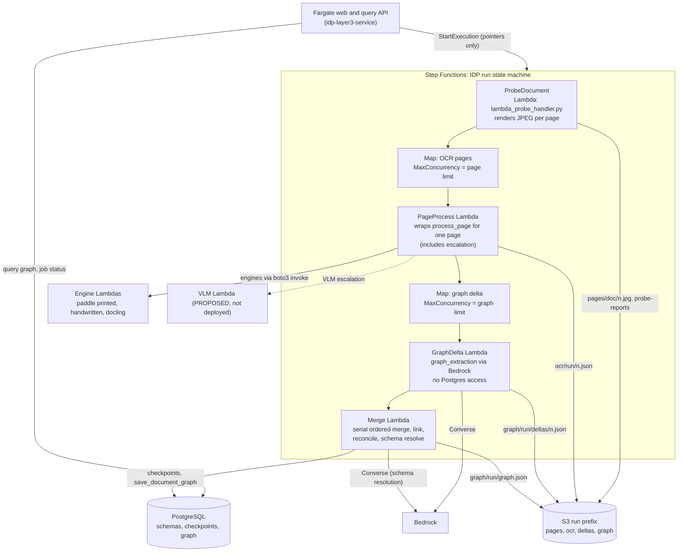

# Hybrid Step Functions design for the IDP pipeline (PROPOSED)

Status: design only. No code, AWS resource, or deployment was changed. Every "current code" claim cites file and line. Items labeled PROPOSED do not exist in the repo today.

Companion sources: `.agents/tasks/latest-run-latency-concurrency.md` (run `job_988e2a763956`, 76-page document, 492 s wall clock) and `.agents/tasks/probe-contract-findings.md`.

---

## 0. Summary answer

- A hybrid is viable. Put three fan-outs in Step Functions Map states: the probe and OCR per page, and the Layer-3 per-page graph delta. Keep one ordered merge worker for the Layer-3 graph state. Keep Fargate as the web, query, and job-status tier.
- The code supports the Layer-3 split. The per-page delta build does not read the shared graph. The context lookup returns an empty list during the build phase, because nothing merges until the build phase ends (`extractor.py:501-521`, `memory_manager.py:876-877`). The merge must stay one ordered reducer, because the merge result depends on page order.
- The existing `step_functions/state_machine_with_probe.asl.json` is not a drop-in. It has no escalation step for low-confidence pages, no route normalization, an undeployed VLM Lambda, and it accumulates every page's full output in state, which can exceed the 256 KB state cap.
- Worth it now? Not for single-document interactive use. The latest run spent most of its time in two fan-out phases that the current code already runs at 16 and 25 concurrent calls. Step Functions pays off with several documents in flight, documents well above 76 pages, and needs for per-page retry and per-execution history. Do the two cheap fixes in section 7 first, then decide.

---

## 1. Current vs proposed architecture

### 1.1 Current (one Fargate container runs everything)

1. `run_pipeline` / `_run_pipeline_job` runs in a background thread (`schema_chatbot_v2/app/api/pipeline_routes.py:489`, `:599`).
2. `_build_pages_for_pdf` renders every page at `RENDER_DPI = 150` into a numpy array and a PNG, all at once (`pipeline_routes.py:114`, `:142-167`, call at `:678`). This is the main Fargate memory cost.
3. `process_document` runs the optional in-process probe when `settings.probe_enabled` is set (`src/ai/layer1_routing/pipeline.py:779-781`, `_run_document_probe` at `:673`). It then runs pages in a `ThreadPoolExecutor` sized by `page_concurrency_limit` (`pipeline.py:770`, `:817-820`).
4. Each page goes through `process_page` (`pipeline.py:346`). That function picks an engine, calls the engine, and can escalate to VLM when confidence is low (`pipeline.py:566`). Paddle OCR calls go to Lambda via `boto3 lambda.invoke`, with the page image sent base64 in the payload (`src/ai/layer2_conversion/scanned.py:59`, `:105-114`, client timeout `read_timeout=300` at `:48`).
5. Layer 3 runs `extract_with_graph_memory_concurrent` (`src/ai/layer3_extraction/extractor.py:336`). It builds page deltas in parallel through a thread pool sized `min(graph_concurrency_limit, 32)` (`extractor.py:506`), then merges serially in page order (`extractor.py:515-521`), then reconciles, links, resolves the schema in one LLM call, and saves the graph (`extractor.py:565-578`).
6. The web and query API is in the same process (`schema_chatbot_v2/app/api/pipeline_routes.py`, query bot at `:1739`).

### 1.2 Proposed hybrid

Notes on the diagram:

- The engine and VLM arrows show the calls that happen inside the PageProcess Lambda. They are not Step Functions states.
- Layer 1 inspection (`src/api/lambda_layer1_handler.py`, deployed with 1024 MB and 120 s in `scripts/deploy_idp_lambdas.py:133-146`) can run as an optional first state, ahead of the probe.

### 1.3 Trigger and state list

| Item | Proposed | Current reference |
|---|---|---|
| Trigger | Fargate API calls `StartExecution` with the S3 key, `document_id`, `schema_id`, and `run_id`. Keep API triggering first, because it keeps the existing job routes working. | `run_pipeline` at `pipeline_routes.py:489`, `extract_uploaded_document` at `:1316` (body not read in full). |
| Upload to S3 | Unchanged. The admin upload endpoint `pipeline_routes.py:227` stays. | `src/ai/layer3_extraction/s3_documents.py`, prefix `settings.s3_documents_prefix = "documents"` (`src/config/settings.py:118`). |
| States | Layer1 (optional) → ProbeDocument → Map OCR (PageProcess) → Map GraphDelta → MergeGraph → end | `state_machine_with_probe.asl.json` has ProbeDocument → Map → FormatWorkflowOutput. |
| Run output | Fargate reads the S3 manifest and rebuilds the existing markdown, IR, and report outputs (`pipeline_routes.py:678-760`). | Current outputs come from `process_document` return values. |

---

## 2. Component map: what moves and what stays

| Component | Today (file : symbol) | Proposed home | Reason |
|---|---|---|---|
| PDF render to RAM | `pipeline_routes.py:142 _build_pages_for_pdf` | Removed from Fargate. The probe Lambda renders one JPEG per page to S3, and each PageProcess Lambda opens the PDF itself. | Removes the all-pages-in-RAM step. |
| Layer-1 inspection | `src/ai/layer1_routing/inspect.py`, `pipeline.py` (not read in full) | Optional Lambda (`src/api/lambda_layer1_handler.py`, which already exists) | Already a Lambda. Stateless per document. |
| Probe (L1.5) | `src/ai/layer1_probe/probe.py:probe_document`, `pipeline.py:_run_document_probe` | `src/api/lambda_probe_handler.py:lambda_handler`, which exists but is not deployed in the state machine (`Dockerfile.probe:25`) | Handler exists. Runs once per document. |
| Per-page process (route, OCR call, escalation, merge of engines) | `pipeline.py:346 process_page` | PROPOSED: PageProcess Lambda that calls the existing `process_page` for one page. Keeps escalation and engine merge unchanged. | The whole per-page decision lives in `process_page`. Splitting it into SFN states would re-implement the escalation ladder (see section 5.2). |
| Paddle OCR engines | `docker/paddle_printed/handler.py`, `docker/paddle_handwritten/handler.py`, `docker/docling/handler.py` | Unchanged Lambda images (`scripts/deploy_idp_lambdas.py:170`: 3008 MB, 300 s). Use the S3 image path (`handler.py:77-88`) instead of base64. | The S3 path already exists. |
| VLM transcription | `pipeline.py:149-154` (in-process) and `${VLM_LAMBDA_ARN}` in the ASL | Not deployed. Keep the in-process call until a VLM Lambda is built. | Undeployed resource. |
| Graph delta build | `src/ai/layer3_extraction/graph_agent/agent.py:79 build_page_delta_async` | PROPOSED: GraphDelta Lambda that calls the same method with `context=[]`. | Stateless (section 3.3). |
| Graph merge, link, reconcile, schema | `extractor.py:515-578`, `memory_manager.py:913` (ingest), `:505` (link), `:1244` (reconcile), `resolver.py` | PROPOSED: Merge Lambda. Same code, reads deltas from S3. | Serial and order-dependent (section 3.2). |
| Checkpoints | `storage.py:751 save_page_checkpoint`, `:877 list_page_checkpoints`, column `page_delta_json` at `:232` | Written by the Merge Lambda, not the GraphDelta Lambda. | Keeps GraphDelta Lambdas out of the VPC. |
| Final graph persistence | `storage.py:601 save_document_graph`, `:657 get_document_graph` | Merge Lambda writes the same rows. | Query path reads the same table. |
| Query and evidence API | `graph_agent/query_service.py`, `evidence_retriever.py`, `pipeline_routes.py:1739` | Stays on Fargate. | Synchronous request and response (section 5.3). |
| Pause, kill, job status | `pipeline_routes.py:380` (status dict), `:387` pause, `:406` resume, `:425` kill, `JobControl` class | Stays on Fargate for status. Kill maps to `StopExecution`. Pause has no native SFN equivalent (section 5.2). | Current controls work on in-process threads. |

---

## 3. The Layer-3 state problem

### 3.1 What the graph merge touches

All of this state lives in one `GraphMemoryManager` object per run (`extractor.py:379`):

- `GraphMemory` nodes and edges (`graph_memory.py`). Edges and nodes are created and fused in place.
- `_ingested_deltas`, the idempotency map keyed by page number and checksum (`memory_manager.py:913-945`).
- `_id_remap`, which maps `(page, local id)` to a canonical id (`memory_manager.py:188-189`). A later page can point at a node created by an earlier page.
- `resolve_entity` (`memory_manager.py:657`). It scores each incoming entity against existing candidates, checks contradictions, applies a margin rule, and then decides `new_entity`, `confirmed`, `uncertain`, or `contradiction`. The candidate set is the current graph, so each decision depends on every earlier merge.
- `_unresolved` references, and the `reconcile_cross_references` pass that needs the full graph (`memory_manager.py:1244`).
- `link_cross_page` (`memory_manager.py:505`), which adds same-entity edges across pages after the merge.
- `resolve_schema_from_graph` (`resolver.py`), which formats the whole graph into one LLM prompt (`format_graph_evidence_for_resolution`).

The async lock `self._lock` (`memory_manager.py:186`) protects this state inside one process. It does nothing across Lambda invocations.

### 3.2 Why this does not fit a stateless Map

- Each merge decision reads the graph as left by all previous merges. Two pages that mention the same entity can resolve to different outcomes depending on which was merged first.
- The existing code already fixed the merge order to page number for determinism (`extractor.py:515`, the comment on the sorted pass). A parallel merge would break this. The repo's merge-determinism work exists to prevent that.
- `reconcile_cross_references` and `link_cross_page` need the whole graph after every page is in.
- So the merge must stay a single ordered reducer. A Map over merges is wrong.

### 3.3 Why the per-page delta build does fit a Map

The delta build is stateless with respect to the graph, and the code says so:

- `agent.py:79-86` documents `build_page_delta_async` as stateless with respect to `self.graph`, and it must not mutate it.
- In `extract_with_graph_memory_concurrent`, `context = await manager.get_context_for_page(page_num)` runs at dispatch (`extractor.py:447`). Merging only starts after `asyncio.gather` finishes (`extractor.py:501-521`). The graph is therefore empty during the build, and `get_context_for_page` returns `[]` when `self.graph._nodes` is empty (`memory_manager.py:876-877`). The `existing_nodes` argument the LLM receives is always empty in this mode.
- So the delta is a function of `(page markdown, blocks, page number, total pages, schema fields)`. That is exactly what a Map item can receive.
- Caveat: the context mechanism is effectively dead in concurrent mode. It stays in the code for the other two modes.

Modes that break this split: `extract_with_graph_memory_ordered` (`extractor.py:130`, context fetched after earlier merges at `:227`) and `extract_with_graph_memory_batched` (`extractor.py:615`, context at `:696`). The hybrid supports only `graph_memory_concurrent`. The default in settings is `layer3_strategy = "graph_memory_concurrent"` (`src/config/settings.py:69`).

### 3.4 The split, precisely

- Map state "GraphDelta" (PROPOSED). One GraphDelta Lambda per page. It reads `ocr/{run}/{n}.json` from S3 (markdown and blocks). It calls the Bedrock `extract_graph_from_page` (through the same `bedrock_client.py` path), validates the result, and writes `graph/{run}/deltas/{n}.json`. The file holds `PageDelta.to_dict()` plus `compute_page_delta_checksum` (`storage.py:731`). The Lambda does not touch Postgres. `MaxConcurrency` equals `graph_concurrency_limit` (16 in the latest run's task definition, `latest-run-latency-concurrency.md` §4).
- Merge state "MergeGraph" (PROPOSED). One Lambda. It lists `graph/{run}/deltas/`, sorts by page number, and runs the same sequence as `extractor.py:515-578`: `ingest_page_delta`, checkpoint status per page (`save_page_checkpoint`), `reconcile_cross_references`, `link_cross_page`, `resolve_schema_from_graph`, `save_document_graph`. The merge writes `graph/{run}/graph.json` too.
- Resume: a GraphDelta Map item skips when its delta object exists with a matching checksum. The merge keeps the existing checkpoint-recovery block in `extract_with_graph_memory_concurrent` (which fills `recovered_pages` and `built_deltas` from `list_page_checkpoints`), so a re-run replays the stored deltas.

### 3.5 Does the 15-minute Lambda limit hold?

Measured in the latest run (`latest-run-latency-concurrency.md` §3.3 and §4):

- 82 graph calls summed to 3,518 s. Run in one serial Lambda, that is 58.6 minutes. The 15-minute Lambda limit rules that out, so the delta calls must fan out. The Map does this.
- Each delta call took p50 38.5 s, p90 62.0 s, max 95.9 s. One Lambda per page fits easily within 15 minutes.
- Lambda timeout must cover the Bedrock retry budget. The code sets read timeout 240 s and 2 attempts (`bedrock_client.py`, `_bedrock_runtime_config`, per the latest-run report §5). Worst case is about 480 s plus connect time. Set the GraphDelta Lambda timeout to 600 s or more.
- Merge work measured in the latest run: serial merge 11.0 s, cross-page link under 0.1 s, schema resolution 6.7 s, persist under 1 s. Total roughly 20 s. A Lambda is far inside the limit.
- The Map plus merge therefore keeps the serial part short. Only the parallel part needs fan-out.

### 3.6 Merge worker: Lambda or Fargate RunTask?

Recommendation: a Lambda with 2 to 3 GB of memory and a 900 s timeout. Reasons: the merge takes about 20 s today, the code has no ML imports at module level in the build path (verify: importing `graph_agent/__init__.py` also imports `query_service`, which pulls numpy through `evidence_retriever.py`, a light dependency), and an ECS RunTask adds a second cluster interaction.

Trigger for switching to ECS RunTask: a measured merge that approaches 10 minutes. That can happen with very large graphs, because the schema prompt grows with graph size. The latest run sent 174,420 input tokens to schema resolution. Whether the model's context window is close to that is not checked here.

The merge Lambda needs VPC access to PostgreSQL for checkpoints and graph persistence. The GraphDelta and OCR Lambdas do not, which keeps them out of the VPC and avoids NAT cost for them. Checking VPC and NAT setup is an open item (section 8).

### 3.7 Graph and query after the split

The query path (`query_service.py`, `evidence_retriever.py`) reads the saved graph from `storage.get_document_graph` (`storage.py:657`). The save location does not change, so the query code does not change. The S3 `graph.json` is an extra copy for audit and replay.

---

## 4. S3 data contract between states

SFN payloads are capped at 256 KB per state (AWS announced the increase from 32,768 characters to 256 KB in 2020; see the AWS Compute blog post "Introducing larger state payloads for AWS Step Functions"). Every large value goes to S3. States pass pointers (bucket, key, count, checksum).

Bucket and prefix: `s3://{doc_bucket}/` for the source PDF, and `s3://{image_bucket}/` for run artifacts, following the probe's `IMAGE_BUCKET` default. `run_id` equals the SFN execution name, which the API sets to the job id.

| # | Object | Key pattern | Producer | Consumer | Content | Size note |
|---|---|---|---|---|---|---|
| 1 | Source PDF | `s3_key` (existing input) | Upload endpoint | Probe, PageProcess | PDF bytes | Latest run: 4.47 MB, 76 pages. |
| 2 | Page image | `pages/{doc}/{n}.jpg` | Probe Lambda (`probe.py` `_upload`) | Engine Lambdas via `image_s3_key` | JPEG at 144 dpi | Contract: `image_s3_bucket`, `image_s3_key` (`docker/paddle_printed/handler.py:56-88`). |
| 3 | Probe report | `probe-reports/{doc}.json` | Probe Lambda (`lambda_probe_handler.py:_slim`) | Audit only | Full per-page report | Written when `IDP_PROBE_SLIM_OUTPUT=1` (default). |
| 4 | Probe result in state | (state, not S3) | Probe | Map | Slim per-page dict: `page_number, route, ocr_lang, use_structure, status, script, has_table, image_s3_bucket, image_s3_key` | Handwriting probability is not in the slim field list, so it is dropped as stated. |
| 5 | Per-page OCR result | `ocr/{run}/{n:04d}.json` | PageProcess Lambda | GraphDelta, Fargate assembly | `{page_number, engine, markdown, confidence, blocks, escalated, status, latency_ms}` | Markdown alone is 153,200 bytes for the 76-page run (`dataset_output/...md`). Blocks size not measured. Never return this in state. |
| 6 | Per-page graph delta | `graph/{run}/deltas/{n:04d}.json` | GraphDelta Lambda | Merge | `PageDelta.to_dict()` plus `checksum` | Checksum from `storage.py:731`. Idempotent. |
| 7 | Run manifest | `runs/{run}/manifest.json` | PageProcess (per-page status) and Fargate (start) | Map, merge, Fargate | Page count, schema_id, total_pages, status per page | Small. Keeps the Map item list out of state. |
| 8 | Final graph | `graph/{run}/graph.json` | Merge Lambda | Audit, replay | `GraphMemory.snapshot()` | Saved graph for the latest run was 37,649 bytes (`dataset_output/...graph.json`). |
| 9 | Final schema result | `runs/{run}/extracted.json` | Merge Lambda | Fargate, UI | Output of `resolve_schema_from_graph` | Current equivalent: `dataset_output/...extracted.json`. |

The Map `ItemSelector` for the OCR Map passes `{document_id, s3_bucket, s3_key, page_number, route, image_s3_bucket, image_s3_key, ocr_lang, use_structure}`. That is the same contract as today's probe-enabled ASL (`state_machine_with_probe.asl.json:57-68`), except that `page` (the whole slim object) is no longer needed.

State results: the ASL's `FormatWorkflowOutput` currently returns `$.results`, every page's full output (`state_machine_with_probe.asl.json`, `ResultPath: "$.results"` on the Map). With 153 KB of markdown plus blocks, that result set can exceed 256 KB. The fix is to return only `{page_number, ocr_key, status}` per item and let the rest sit in S3.

---

## 5. What this fixes, and what it costs

### 5.1 Fixes

| Problem today | What the hybrid changes | Limit to keep in mind |
|---|---|---|
| Fargate OOM at 4 GB, fixed at 8 GB (from the brief). All pages rendered at once (`pipeline_routes.py:142-167`). | Each probe render and each PageProcess call holds one page. Fargate stops rendering pages. | The probe Lambda still reads the whole PDF into memory (`lambda_probe_handler.py`, `get_object(...)["Body"].read()`). Its memory size needs a measured setting. Per-page memory in `probe.py` was not traced line by line. |
| Concurrency set by env vars (`settings.py:70` `graph_concurrency_limit = 8`, `:106` `page_concurrency_limit = 25`; latest run used 16 and 25) | Map `MaxConcurrency` replaces both. Each Map is independent. | Account Lambda concurrency is 400 (latest-run report §7.3). Bedrock throughput quota for the inference profile was not checked. |
| Bedrock timeouts and retries are hand-coded (`bedrock_client.py`) | Keep them. SFN Retry covers Lambda-level failures (`Lambda.ServiceException`, etc.) with declarative backoff. | SFN Retry does not see truncation. A truncated model answer is a successful response, so the five truncated pages (12, 14 to 17) are still lost. Fix that in the model call. |
| Observability: logs and in-memory `_pipeline_jobs` (`pipeline_routes.py:380`) | Per-execution history in SFN, persisted across Fargate restarts. | Inline Map is for history under 25,000 entries and at most 40 concurrent iterations (AWS docs, "Map workflow state"). Above that, use Distributed Map. |
| Resume | Per-page delta objects in S3 plus the existing checkpoints. | Checkpoint writes stay in Postgres through the merge worker. |

### 5.2 Costs and risks

1. Escalation is missing from the ASL. `process_page` escalates to VLM when OCR confidence is low (`pipeline.py:566`). In the latest run, page 64 escalated (OCR 0.54 against a 0.70 threshold). The ASL routes every page straight to one engine with `End: true` (`state_machine_with_probe.asl.json`, `InvokePaddlePrinted`, etc.), so it would lose that behavior. This is why the design keeps `process_page` inside a PageProcess Lambda.
2. Route vocabulary mismatch. The Choice state matches the probe route strings `skip`, `docling`, `paddleocr_handwritten`, `vlm_transcribe`, and defaults to `paddleocr_printed` (`state_machine_with_probe.asl.json`, `RouteEngineChoice`). In-process code uses `digital`, `scanned`, `handwritten`, `vlm_transcribe`, `skip` (`router.py:22` `VALID_ROUTES`), and maps `docling` to `digital` (`capability_router.py:245-261`). Any `digital` or `scanned` value would go to the Paddle printed engine by default. A normalization Pass state, or a single vocabulary, must come first.
3. Undeployed VLM. `${VLM_LAMBDA_ARN}` does not exist (`docs/PROBE_INTEGRATION.md`). Keep VLM calls in-process until a VLM Lambda is built.
4. Undeployed probe Lambda. `${PROBE_LAMBDA_ARN}` is not set. The probe image `Dockerfile.probe` uses `public.ecr.aws/lambda/python:3.12` as its base (line 6). Its cold-start cost was not measured. The probe loads ONNX and VLM clients once per warm container (`lambda_probe_handler.py`, `_load_models`).
5. Cold starts. Paddle printed Lambda init was 0.75 to 1.28 s on 25 cold starts (latest-run report §3.2), so cold starts are small for OCR. GraphDelta Lambdas import pydantic and the Bedrock adapter. Their init was not measured. Provisioned concurrency is not needed unless measured init is large.
6. DPI parity. The probe renders at 144 dpi (`docs/PROBE_INTEGRATION.md`). The in-process path renders at 150 dpi (`pipeline_routes.py:114`). OCR output can shift slightly. Re-check OCR quality on a sample before cutover. Also confirm that the S3 JPEG path resizes to 1200 px as the in-process path does (`scanned.py`, resize block before `:105`).
7. VPC and networking. The merge Lambda needs VPC access to PostgreSQL. The ECS task runs in a VPC today (network details not read in this investigation). Adding Lambdas to the VPC needs subnets and a NAT route for Bedrock and S3 access, or VPC endpoints.
8. Pause semantics. The current pause endpoint (`pipeline_routes.py:387`) stops a thread between PDFs. SFN has no pause. Options: a `Wait` state that polls a DynamoDB or Postgres flag, or a task token. Either adds work. Kill maps to `StopExecution`.
9. Two systems to operate. Fargate and SFN both own state now. Job status must come from SFN execution data or a DB row written by the API.
10. Duplicate flags. Two probe flags already exist: `IDP_ENABLE_PROBE` (`pipeline.py:62-64`, used by `_maybe_probe_route`) and `IDP_PROBE_ENABLED` (`settings.py:344`, used by `process_document` at `pipeline.py:779`). The orchestrator switch needs one clear name.
11. Org SCP. The brief mentions an earlier org SCP that blocked some Step Functions and ECS actions in some regions. Not verified in this investigation. Check the deploy role has `states:*` in ap-south-1 before Phase 1.
12. Earlier doc drift. `.agents/tasks/probe-contract-findings.md` says slimming is missing from `probe.py`. The slimming is actually in `lambda_probe_handler.py:_slim` (line 99), default on. That is consistent with the probe contract, but the earlier note's location was wrong.

### 5.3 Query path

The query bot (`pipeline_routes.py:1739`) and the evidence retriever are synchronous request and response. They must stay on Fargate. SFN is a poor fit for a web request, and the Lambda 6 MB synchronous payload limit (AWS Lambda docs) also rules out returning graph payloads through Lambda. The graph is read from PostgreSQL, so the query path does not move.

---

## 6. Phased migration (flag-guarded, reversible)

Each phase has an env flag. Turning the flag off restores the in-process path, and no data format changes for existing jobs.

Phase 0. Decisions and checks, no code.
- Pick the per-page unit: PageProcess Lambda wrapping `process_page` (recommended).
- Unify route vocabulary.
- Confirm the deploy role can create state machines, Lambdas, and VPC config in ap-south-1.
- Confirm the exact pytest command from `AGENTS.md` and `README.md` (not read in this investigation).

Phase 1. Layer 1.5 and Layer 2 in SFN. Layer 3 unchanged.
- Flag `IDP_ORCHESTRATOR=inprocess|sfn` (default `inprocess`).
- Deploy the probe Lambda image from `Dockerfile.probe`. Deploy the PageProcess Lambda.
- Replace the ASL with a version that returns S3 pointers, not page results.
- Fargate reads `ocr/{run}/*.json` and rebuilds `pages_for_layer3` and the existing outputs (the output block starting at `pipeline_routes.py:678`).
- Verification: run the project's pytest suite. Run one 76-page document through both paths. Compare the OCR markdown per page and the final `.md` file for equality or small diffs. Compare wall clock.
- Rollback: set the flag to `inprocess`.

Phase 2. Layer 3 graph delta Map and merge worker.
- Flag `IDP_LAYER3_EXECUTOR=inprocess|sfn`, independent of phase 1.
- Deploy GraphDelta and Merge Lambdas. Merge Lambda in the VPC.
- Keep `extract_with_graph_memory_concurrent` unchanged for `inprocess`.
- Verification: pytest for `tests/` under `schema_chatbot_v2` and the Layer-3 tests. Run the same document. Compare node count, edge count, and `graph.json` snapshot. Expect the same counts, because the delta is deterministic on inputs (LLM output still varies).
- Rollback: flag off.

Phase 3. Cleanup.
- Remove the in-process paths only after a period of clean runs. Keep the query path.
- Replace the in-memory `_pipeline_jobs` with DB status.
- Decide the pause design.

---

## 7. Effort, recommendation, and when it pays off

### 7.1 Rough effort (engineering estimate, not measured)

| Phase | Work | Rough effort |
|---|---|---|
| 0 | Decisions, vocabulary, permission checks | 1 to 2 days |
| 1 | Probe and PageProcess Lambdas, ASL rewrite, Fargate assembly, flag, parity test | 4 to 6 days |
| 2 | GraphDelta and Merge Lambdas, S3 contract, VPC, checkpoint writes, parity test | 5 to 8 days |
| 3 | Cleanup, job status, pause design | 2 to 4 days |

Plus infrastructure time for IAM, VPC, and CI. Estimates are judgment, not measured.

### 7.2 Recommendation

Do not build the full hybrid now for single-document interactive use. The latest run's critical path is OCR (202 s) plus graph fan-out (235 s), and the current code already runs both at 16 to 25 concurrency. A Step Functions Map would run those same lanes. Expected gains come from retries, history, and memory headroom, not from a shorter critical path. SFN transitions and S3 round trips add time that I did not measure.

Do these first, because they help either design:

1. Fix the five truncated pages (12, 14 to 17). They cost 780.8 s of lane time and produce no graph output (latest-run report §3.3 and §7 item 1). Raise the retry output cap if the model allows it, split dense pages, or ask for more compact JSON.
2. Surface degraded pages in the job result. Right now the job ends clean (latest-run report §7 item 4).
3. Measure the probe's memory and time on a larger PDF, so a Lambda size can be set.

Revisit the hybrid when one or more of these holds:

- Several documents run at once, and Fargate task count or memory becomes the limit.
- Documents exceed a few hundred pages, where in-process memory and the 4 to 8 GB ceiling become the risk.
- Per-page retry, per-page timeout, and durable execution history are needed for audit.

Recommended first build, if you choose to proceed: Phase 1 only. It moves the memory-heavy page rendering and OCR fan-out out of Fargate, keeps all Layer-3 code unchanged, and is reversible with one flag.

---

## 8. What was verified and what was not

Verified by reading code in this workspace:

- ASL definitions, probe handler, Paddle handler, pipeline and extractor call paths, memory manager, agent, storage functions, and the latest-run report.
- Route vocabularies in `types.py`, `router.py`, `capability_router.py`.
- Lambda memory and timeouts from `scripts/deploy_idp_lambdas.py` and `scripts/deploy_layer1_lambda.py`.

Verified from AWS documentation (web search, not from this account):

- Inline Map limits (25,000 history entries, 40 concurrent iterations).
- Lambda synchronous payload limit of 6 MB and 15-minute maximum timeout.
- The 256 KB Step Functions state payload limit.

Not verified in this investigation:

- No AWS calls were made. Current deployed topology, the account Lambda concurrency value beyond the latest-run report, and the Bedrock quota were not re-checked.
- Blocks size per page is unknown. Only the markdown size (153 KB) was measured.
- Probe per-page memory and init time were not traced.
- The VPC and NAT configuration of the Fargate service was not read.
- Layer-1 inspection internals (`inspect.py`) were not read.
- The exact pytest commands in `AGENTS.md` and `README.md` were not read.
- The org SCP from the brief was not checked.

Read-only: nothing in the repo or on AWS was changed.
